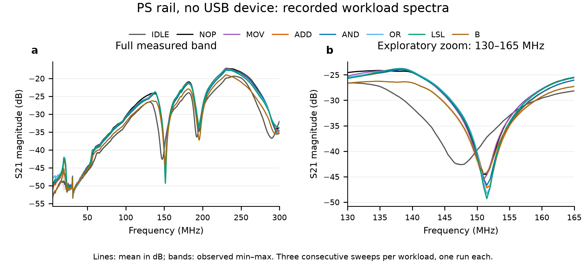
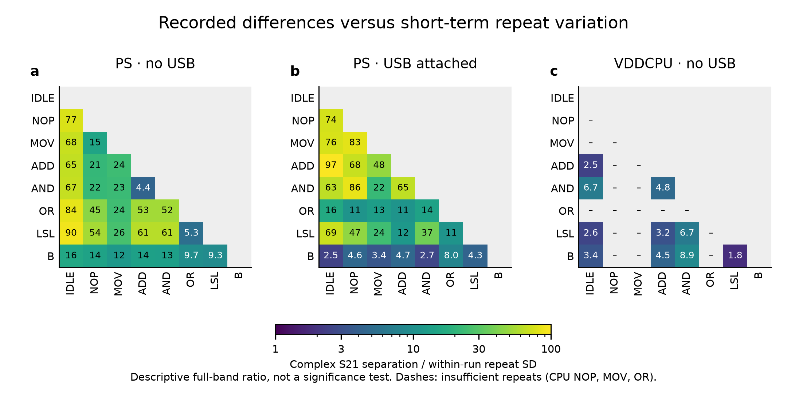
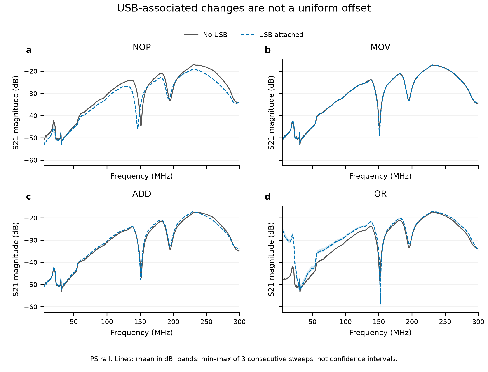
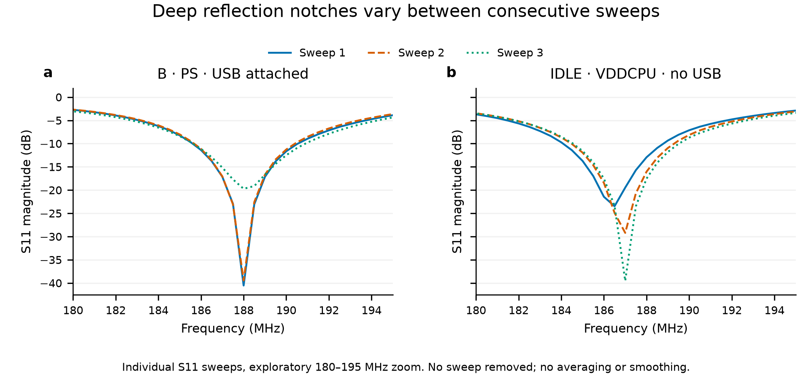

The recordings show workload-associated differences in the measured response, clearest on PS without a USB device. They are promising evidence for further experiments, but do not yet establish reliable instruction identification across independent runs.

I analysed 66 labelled Touchstone traces covering 5–300 MHz. The six unnamed traces were excluded as agreed; nine proprietary `.cst` instrument-state files were not decoded. All labelled sweeps were retained.

| Probe location and USB state | Workloads | Sweeps |
|---|---|---:|
| PS–GND, no USB device | IDLE, NOP, MOV, ADD, AND, OR, LSL, B | 3 per workload; 24 total |
| PS–GND, USB device attached | Same eight | 3 per workload; 24 total |
| VDDCPU–GND, no USB device | Same eight | 3 for IDLE/ADD/AND/LSL/B; 1 for NOP/MOV/OR; 18 total |

Repeats are consecutive sweeps of one run, not independent reset/provision cycles. The filename `OR` is retained throughout; interpreting it as the runtime's `ORR` workload is an assumption. The files do not record a firmware revision or independently verify the running workload.

1. **IDLE differs clearly from the active workloads on PS without USB.** In the exploratory 130–165 MHz window, IDLE's mean S21 minimum is at 147.5 MHz, while all seven active workloads have minima at 151.0–151.5 MHz. This is a 3.5–4 MHz displacement on the sampled grid. In the current source, IDLE uses `WFE`; NOP continuously executes instructions. Their differing responses are consistent with that distinction, although the measurements alone do not establish its mechanism.

   | Workload | S21 notch frequency (MHz) | Mean S21 at notch (dB) |
   |---|---:|---:|
   | IDLE | 147.5 | −42.63 |
   | NOP | 151.5 | −44.55 |
   | MOV | 151.0 | −45.48 |
   | ADD | 151.5 | −47.18 |
   | AND | 151.5 | −46.66 |
   | OR | 151.5 | −48.42 |
   | LSL | 151.5 | −49.33 |
   | B | 151.0 | −44.43 |

   These are transmission minima, not impedance or power-consumption rankings. Frequencies were selected after inspecting the data, and the local grid spacing is 0.5 MHz.

2. **Some active workloads are much closer to one another.** On PS without USB, ADD–AND is the closest pair by the full-band complex-S21 separation/repeatability ratio: 4.42. OR–LSL is next at 5.33. Their mean-magnitude differences have full-band RMS values of 0.446 and 0.261 dB, respectively. IDLE–NOP is much farther apart by the complex ratio, at 77.2. Thus, distinguishing an idle state from an active loop looks easier here than distinguishing certain active instructions.

   These ratios compare different workload runs against variation between consecutive sweeps. They are not significance levels or classification accuracies. MOV–OR also differs in this dataset, but that cannot isolate an execution unit: the runtime uses different operands, and register MOV is an alias of an ORR encoding. Likewise, B is a branch workload, but its response does not by itself identify a branch-specific electrical signature. No conclusions follow for the unmeasured workloads such as MOVZ, ADDS, SUB, EOR, LSR or conditional branches.

3. **USB state must be controlled; its associated changes are not a constant offset.** The full-band RMS difference between USB and no-USB mean S21 magnitudes is 4.716 dB for OR, 2.932 dB for NOP, 1.580 dB for B, 0.846 dB for ADD, and only 0.278 dB for MOV. OR's low-frequency response changes especially strongly. All its sweeps remain in the analysis. These differences can exceed differences between instruction workloads, so pooling the two USB conditions would be misleading. The files cannot separate USB effects from acquisition-order, settling or contact changes.

4. **PS without USB was more repeatable than VDDCPU in these recordings.** For the five workloads with three sweeps in every setup—IDLE, ADD, AND, LSL and B—the median full-band RMS sweep SD of S21 magnitude is 0.127 dB on PS without USB, 0.270 dB on PS with USB, and 0.711 dB on VDDCPU without USB. The latter is about 5.6 times the first. This describes these sessions, not an intrinsic advantage of the PS rail. CPU NOP, MOV and OR have only one sweep, so their repeatability cannot be estimated.

   Deep reflection notches are particularly unstable in dB. At 188 MHz, the three B/PS/USB S11 values are approximately −40.54, −39.46 and −19.72 dB. At 187 MHz, IDLE/VDDCPU/no-USB spans approximately −39.54 to −19.47 dB. A roughly 20 dB notch-depth change is therefore possible without changing the workload label. The logarithm amplifies relative changes near a reflection zero; these are not 20 dB changes in impedance or CPU power.

Your description—two signal/return pairs, one per VNA port, connected to the same rail and GND—is consistent with shunt-through. The actual pin mapping and calibration reference plane remain unverified. The exports report full two-port SOLT calibration, but that does not establish where it was performed. Their S11 and S22 responses also differ substantially. I therefore retained measured S parameters and did not convert them into absolute impedance. Impedance conversion depends on the measurement topology and reference plane; see [Keysight's measurement-method definitions](https://helpfiles.keysight.com/csg/e5061b/quick_start_guide/impedance_measurement/measurement_procedure.htm).

Each labelled trace contains 802 rows, including two entries at the 100 MHz segment boundary. Those two complex values were averaged within each sweep, producing 801 unique frequencies. The [Touchstone specification](https://ibis.org/connector/touchstone_spec11.pdf) defines the two-port ordering as S11, S21, S12, S22; these files specify real/imaginary values and a 50 Ω reference.

Magnitude plots use `20 log10(abs(S))` per sweep, then the arithmetic mean in dB. Shading is the observed minimum–maximum, not a confidence interval. No smoothing was applied. Band summaries use trapezoidal frequency integration divided by bandwidth, so the denser 5–100 MHz segment is not over-weighted. For the heatmap, the numerator is the RMS complex difference between workload means; the denominator is the square root of the frequency-averaged mean of their two sample complex variances. Both workloads require at least two sweeps. Frequencies are not treated as independent experimental replicates.

The next useful experiment is to repeat IDLE, NOP, ADD and AND through independent reset/provision cycles in randomized order, keeping USB state and probe contact fixed. Keep the three consecutive sweeps nested within each run. Include a return to the starting workload to expose drift, and record firmware revision, workload acknowledgement, timing and VNA settings. Any later classifier should hold out whole runs; splitting consecutive sweeps across training and testing would overstate generalization.

The reproduction script is [analyze.py](analyze.py); it requires Python with NumPy, pandas and Matplotlib. Raw measurements are stored separately from this repository. Run `python3 analyze.py /path/to/VNA-h616-instruction-repetitions --plot` from this directory. Numeric outputs are [pairwise comparisons](pairwise_comparisons.csv), [repeatability](repeatability.csv), [USB comparisons](usb_comparisons.csv) and [plotted spectra](plotted_spectra.csv). The [inventory](inventory.csv) records input hashes and exclusions; [metadata](analysis_metadata.json) records versions and preprocessing. Each figure is also available as PDF and SVG. QA results are under `qa/`.

Not checked: physical probe mapping, calibration accuracy, acquisition settings stored in `.cst`, or workload execution during acquisition. These results establish recorded response differences and within-run repeatability; drift, setup changes and unverified workload labels remain possible explanations for part of the separation.
